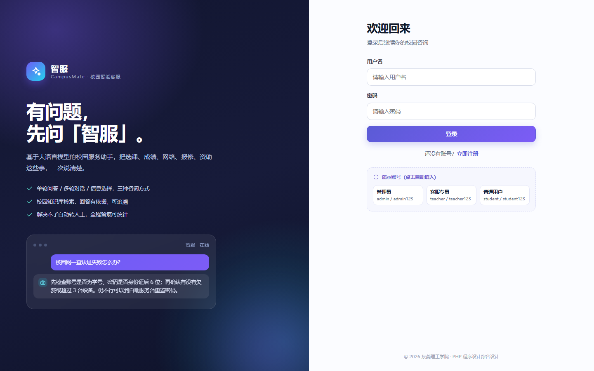
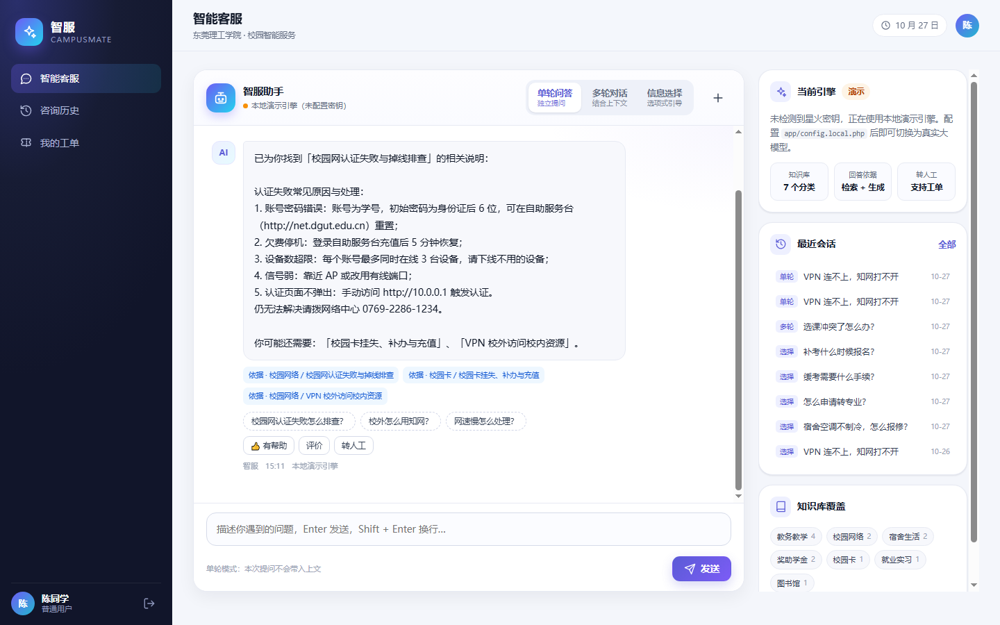
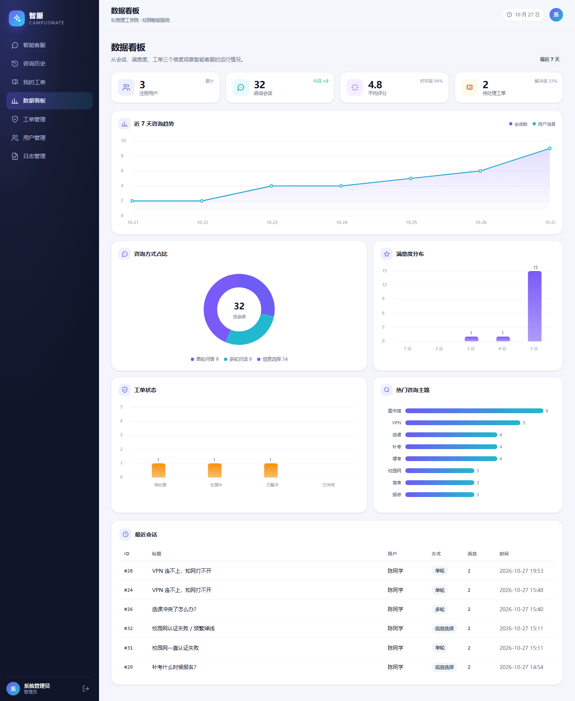
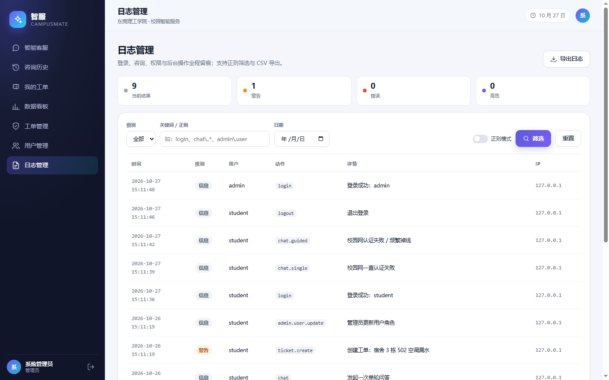
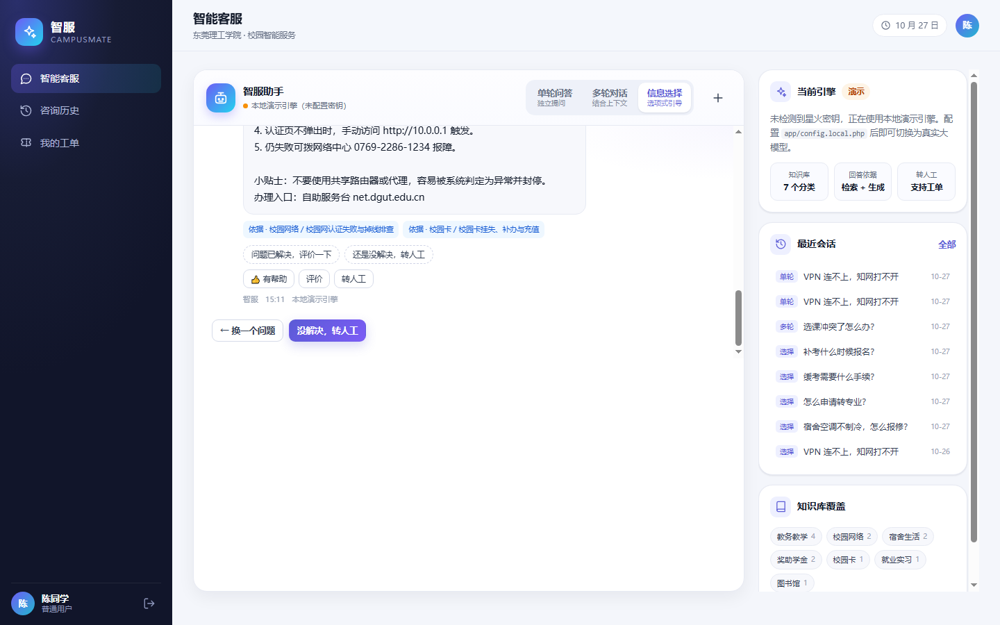
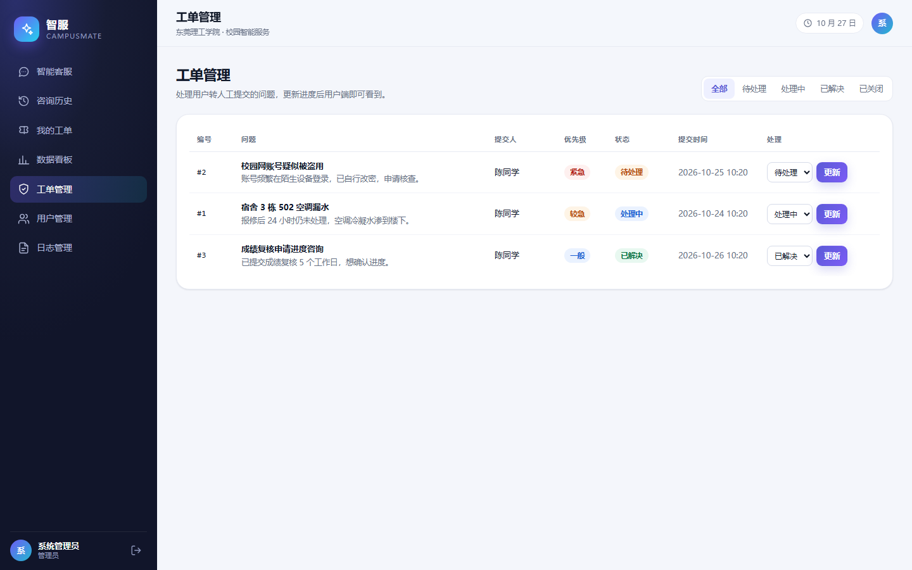

# 智服 CampusMate · 校园智能客服

> 校园里大量重复咨询占掉了辅导员和教务处的时间：选课冲突怎么处理、校园网认证一直失败、学生证丢了去哪补办……
> 这些问题**有标准答案，却散落在通知、PDF 和老师脑子里**。
>
> CampusMate 把答案收进一个可检索的知识库，用对话的方式回答；答不上来时自动转成工单，落到人工队列——**不让一次求助停在"问了没人回"**。

三种咨询方式（单轮问答 / 多轮对话 / 引导式信息选择）、每条回答带依据、负面情绪自动建议转人工、对话可一键转工单、后台有数据看板与全链路日志。


---

## 界面预览

| 登录 / 注册 | 智能客服（单轮问答·带依据） |
| :---: | :---: |
|  |  |

| 数据看板（Canvas 绘制） | 日志管理（正则筛选） |
| :---: | :---: |
|  |  |

| 信息选择（引导式问答） | 工单管理 |
| :---: | :---: |
|  |  |

> 截图来自本机演示数据；全部 11 张截图见 [`shots/`](shots/)，5 分钟验收流程见 [`docs/验收演示脚本.md`](docs/验收演示脚本.md)。

---

## 三个关键设计决策

这个项目真正花时间的不是功能清单，是下面三件事。它们也是我在面试里最愿意被问的部分。

### 1. 大模型不可用时，系统不能不可用

校园客服的高峰恰好是选课、开学这些时段，任何一次外部服务抖动都会被放大成"系统崩了"。

所以 `provider = auto`：配置了星火密钥就走真实大模型；**调用失败、超时、断网，自动降级到本地演示引擎**，页面不 500、不白屏，右上角显示当前引擎。

本地引擎不是 if-else 问答表——它走 `KnowledgeBase::retrieve()` 的检索，按「结论 → 步骤 → 办理入口 → 延伸问题」组织回答，多轮时承接上文，识别到负面情绪会安抚并建议转人工。

**代价**：两套回答逻辑要维护，且降级后的回答质量必然下降。
**取舍**：宁可回答得笨一点，也不能打不开。

### 2. 权限不是"把菜单藏起来"

学生项目最常见的安全漏洞是：前端隐藏了管理员入口，接口却不校验。

这里做的是**页面 + 接口双重校验**：每个接口先过 Session 鉴权，管理员接口再校验角色；越权访问返回 403 并把这次尝试写进日志（谁、什么时间、想访问哪个接口）。

日志同样是双写：入库便于筛选，按天写文件便于故障时直接 tail。

### 3. 回答必须有依据，不能只是一段话

如果模型给一段看起来很像的答案，用户没法判断该不该信。

所以入库时把命中条目、建议问题、情绪判定、是否建议转人工都塞进 `messages.meta`（JSON），前端据此渲染「依据 / 建议 / 转人工」三块。**用户点得开依据，就知道这句话是从哪条通知里来的。**

---

## 技术栈

| 层 | 选型 | 说明 |
|---|---|---|
| 语言 | PHP 8.0+ | 无框架，手写路由与模板（课程约束） |
| 数据库 | PDO（MySQL / SQLite） | 双驱动，MySQL 不可用时零配置回退 SQLite |
| 前端 | 原生 JS（AJAX / Canvas） | 无 CDN、无构建，断网可完整演示 |
| 大模型 | 讯飞星火（WebSocket） | 纯 PHP 实现客户端，不依赖 Composer |

---

## 文档导航

| 文档 | 内容 |
| --- | --- |
| [`docs/验收演示脚本.md`](docs/验收演示脚本.md) | 5–8 分钟演示流程，含可能被问到的问题 |
| [`docs/星火接入核查报告.md`](docs/星火接入核查报告.md) | 星火 WebSocket 协议逐项核对、网络实测与错误码处理 |
| [`schema/mysql.sql`](schema/mysql.sql) | MySQL 建表脚本（也可由程序自动建表） |
| [`tools/`](tools/) | 18 项接口回归、星火自检、截图等辅助工具 |

---

## 一、快速启动（Windows + XAMPP）

### 1. 环境

- PHP ≥ 8.0（已启用 `pdo_mysql`、`pdo_sqlite`、`mbstring`、`openssl`、`curl`、`json`）
- 本项目在 **XAMPP PHP 8.0.30 + MariaDB 10.4.32** 下实测通过：18 项接口回归 ALL PASS，MySQL 自动建库/建表/写入种子数据均正常
- 兼容 PHP 8.1 / 8.2（代码未使用 8.1+ 专属语法）
- 数据库：默认用 XAMPP 自带 MySQL/MariaDB（`app/config.local.php` 已配置好，root 空密码）；也可一键回退 SQLite 零配置

### 2. 启动

**最简单的办法：双击 `start.bat`。** 它会自动完成三件事：

1. 判断当前用的是 MySQL 还是 SQLite；
2. 若是 MySQL 且 3306 未监听，自动启动 XAMPP 自带的 MySQL 并等待就绪；
3. 启动 PHP 内置服务器，2 秒后自动打开浏览器到 <http://127.0.0.1:8899/login>。

命令行手动启动（MySQL 模式必须先启动 MySQL）：

```powershell
# 1) 启动 MySQL（已在 XAMPP 控制面板点过 Start 的跳过）
C:\xampp\mysql\bin\mysqld.exe --defaults-file=C:\xampp\mysql\bin\my.ini --standalone

# 2) 启动网站
cd /d D:\smart-service
C:\xampp\php\php.exe -S 127.0.0.1:8899 -t public public/index.php
```

- 停止网站：在窗口按 `Ctrl + C`；停止 MySQL：`C:\xampp\mysql\bin\mysqladmin.exe -u root shutdown`（或 XAMPP 控制面板 Stop）。
- MySQL 没启动时页面**不会白屏**，会显示中文「数据库未就绪」提示页（HTTP 503），按提示启动 MySQL 后刷新即可。

### 3. 演示账号

| 角色 | 用户名 | 密码 | 可见功能 |
| --- | --- | --- | --- |
| 管理员 | `admin` | `admin123` | 全部功能 + 用户/日志/工单管理 |
| 客服专员 | `teacher` | `teacher123` | 数据看板、工单处理 |
| 普通用户 | `student` | `student123` | 智能客服、历史、工单、个人中心 |

首次访问会自动创建数据库 `smart_service`、表结构和演示数据（30+ 条历史会话、3 个工单、知识库 13 条）；数据全部写入 MySQL，刷新页面数据不丢。

---

## 二、部署到 XAMPP（Apache + MySQL）

1. 把整个 `smart-service` 目录复制到 `C:\xampp\htdocs\`。
2. 浏览器访问 `http://localhost/smart-service/public/`。
   - `public/.htaccess` 已配置重写，Apache 需启用 `mod_rewrite`（XAMPP 默认开启）。
3. 数据库：仓库内 `app/config.local.php` 已切到 MySQL（`driver = mysql`，root 空密码，库名 `smart_service`）。
   - 首次连接会自动 `CREATE DATABASE` 并建表、写入演示数据；
   - 也可先手动导入：`C:\xampp\mysql\bin\mysql.exe -u root smart_service < schema\mysql.sql`；
   - 想回到 SQLite 零配置：把该文件的 `'driver' => 'mysql'` 改成 `'sqlite'`，或直接删除该文件。
4. 投屏演示 / 部署到局域网时，在 `app/config.local.php` 里加一行 `'debug' => false`，避免把错误细节暴露给观众。

---

## 三、接入讯飞星火

### 1. 申请

在 <https://xinghuo.xfyun.cn/> 创建应用，拿到 `APPID`、`APIKey`、`APISecret`。

### 2. 配置

`app/config.local.php` 已存在（里面有 MySQL 配置），**不要整个覆盖它**，只把 `spark` 一节合并进去：

```php
<?php
return [
    'db' => [ /* ……已有的 MySQL 配置，保留不动…… */ ],

    'spark' => [
        'app_id'     => '你的 APPID',
        'api_key'    => '你的 APIKey',
        'api_secret' => '你的 APISecret',
        'url'        => 'wss://spark-api.xf-yun.com/v3.5/chat',
        'domain'     => 'generalv3.5',
    ],
    'provider' => 'auto', // auto / spark / mock
];
```

配好后先跑一次自检（会打印 DNS / TLS 证书 / 握手 / 逐帧内容 / 最终回答）：

```powershell
C:\xampp\php\php.exe tools\test_spark.php
```

退出码 `0` 即成功；刷新页面右上角应显示 **「讯飞星火在线」**。详细用法见 `tools/spark_selftest.md`。

### 3. 实现说明

`app/Spark/SparkClient.php` 是**纯 PHP 实现**的 WebSocket 客户端，不依赖 Composer：

- 按星火文档生成 HMAC-SHA256 鉴权 URL；
- `stream_socket_client('ssl://...')` + 手写 WebSocket 握手；
- 自行封装/解析 WebSocket 帧（客户端掩码、126/127 长度扩展、ping/pong、close）；
- 逐帧读取 `payload.choices.text[].content`，直到 `header.status = 2`。

`provider = auto` 时：**配置了密钥就走星火，调用失败自动降级到本地演示引擎**，不会让页面 500。页面右上角会显示当前引擎。

> 未配置密钥时默认使用本地演示引擎；星火客户端已按官方 WebSocket 协议实现，并做过本机网络与 TLS 连通性验证，填好 `app/config.local.php` 后即可切换到真实大模型。
>
> 想先验证密钥是否可用：`C:\xampp\php\php.exe tools\test_spark.php --app-id=... --api-key=... --api-secret=...`，用法见 `tools/spark_selftest.md`。

### 4. 本地演示引擎做了什么

`app/Spark/MockProvider.php` 不是简单的 if-else 问答，而是：

1. `KnowledgeBase::retrieve()` 做关键词 + 标题二元组 + 类别加权重排；
2. 按命中条目组织「结论 → 分步骤 → 办理入口 → 延伸问题」；
3. 多轮模式下自动承接上一轮话题；
4. 负面情绪识别后给出安抚并建议转人工；
5. 未命中时主动澄清并给出类别引导。

---

## 四、目录结构

```
smart-service/
├─ app/
│  ├─ bootstrap.php          # 自动加载、Session、DB 初始化（数据库异常时显示中文提示页）
│  ├─ config.php             # 配置（可被 config.local.php 覆盖）
│  ├─ config.local.php       # 本机配置：MySQL 账号密码（已 gitignore）
│  ├─ Database.php           # PDO 封装 + 自动建表 + 种子数据（MySQL / SQLite 双驱动）
│  ├─ Auth.php               # 登录、角色、权限校验
│  ├─ Logger.php             # 入库 + 文件双写、敏感信息脱敏
│  ├─ ChatService.php        # 会话编排、Prompt、持久化
│  ├─ KnowledgeBase.php      # 轻量检索
│  ├─ GuidedFlow.php         # 信息选择的类别/问题/步骤
│  ├─ StatsService.php       # 看板统计
│  ├─ SeedData.php           # 知识库种子数据
│  ├─ Spark/SparkClient.php  # 星火 WebSocket 客户端（纯 PHP）
│  ├─ Spark/MockProvider.php # 本地演示引擎
│  └─ Views/                 # 页面模板
├─ public/
│  ├─ index.php              # 单入口路由 + API
│  ├─ .htaccess              # Apache 重写
│  └─ assets/                # CSS / JS（无 CDN）
├─ schema/mysql.sql          # MySQL 建表脚本（手动部署用）
├─ tools/                    # 开发/验收辅助：接口回归、星火自检、截图
│  ├─ test_all.py            # 18 项接口回归
│  ├─ test_spark.php         # 星火联通自检（有密钥时用）
│  └─ db_driver.php          # start.bat 判断数据库类型
├─ docs/                     # 验收演示脚本、星火接入核查报告
├─ shots/                    # 验收截图
├─ storage/                  # 日志 / 导出 / Session /（SQLite 模式下）app.db，运行时生成
├─ start.bat                 # 一键启动（自动拉起 MySQL + PHP + 打开浏览器）
└─ README.md
```

---

## 五、数据库设计

| 表 | 作用 | 关键字段 |
| --- | --- | --- |
| `users` | 用户与角色 | username, password_hash, role, status |
| `conversations` | 会话 | user_id, mode, title, updated_at |
| `messages` | 消息 | conversation_id, role, content, meta(JSON) |
| `feedback` | 满意度 | message_id, user_id, rating |
| `tickets` | 工单 | title, priority, status, assignee_id |
| `logs` | 操作日志 | action, level, detail, ip |
| `kb_articles` | 知识库 | category, title, keywords, content |

`meta` 字段保存本次回答的来源条目、建议问题、情绪、是否需要转人工等结构化信息，前端据此渲染「依据 / 建议 / 转人工」。

---

## 六、接口一览

| 方法 | 路径 | 说明 |
| --- | --- | --- |
| POST | `/api/chat` | 三种咨询方式统一入口 |
| GET | `/api/guided/tree` | 信息选择类别树 |
| GET | `/api/history` | 会话列表（方式/关键词/正则/日期/分页） |
| GET | `/api/conversation?id=` | 会话详情 |
| POST | `/api/feedback` | 满意度评价 |
| POST | `/api/ticket` | 创建工单 |
| GET | `/api/stats` | 看板数据 |
| GET | `/api/logs/file` | 今日日志文件尾部 |
| GET | `/export?type=history\|logs` | CSV 导出（文件操作） |

所有写接口校验 `X-CSRF-Token`；所有接口经 Session 鉴权，管理员接口二次校验角色。

---

## 七、常见问题

**Q：页面提示「未配置星火密钥」？**
A：正常，说明在本地演示引擎模式。按第三节把密钥填进 `config.local.php` 的 `spark` 一节即可切换真实大模型。

**Q：MySQL 连接失败 / 页面显示「数据库未就绪」？**
A：双击 `start.bat` 会自动启动 MySQL；也可打开 XAMPP 控制面板点 MySQL 的 Start。若你改过 root 密码，把 `app/config.local.php` 里的 `'pass'` 改成新密码。只想先跑起来：把 `'driver' => 'mysql'` 改成 `'sqlite'` 即可零配置启动。

**Q：想清空演示数据？**
A：MySQL 模式：执行 `C:\xampp\mysql\bin\mysql.exe -u root -e "DROP DATABASE smart_service"`，刷新页面会自动重建并重新写入种子数据。SQLite 模式：停止服务，删除 `storage/app.db`（及 `-wal/-shm`）后刷新。

**Q：端口 8899 被占用？**
A：`start.bat` 会检测到端口已在运行并直接打开浏览器；若确实冲突，改 `start.bat` 里的 `PORT` 值，命令和网址一起改。

---

## 八、演示流程（5 分钟）

1. 登录页 → 用 `student / student123` 登录；
2. 单轮问答：「选课冲突了怎么办？」→ 展示依据条目；
3. 切「多轮对话」→ 问「校园网一直认证失败」→ 追问「那还是不行怎么办」→ 展示上下文承接；
4. 切「信息选择」→ 校园网络 → 认证失败 → 展示推荐步骤 → 「没解决，转人工」提交工单；
5. 咨询历史 → 方式/正则筛选 → 查看会话详情 → 导出 CSV；
6. 退出，用 `admin / admin123` 登录 → 数据看板 → 用户管理改角色 → 日志管理用正则 `chat\..*` 筛选 → 工单管理更新状态。

---

## 九、本机验证记录（2026-10-27）

| 项目 | 结果 |
| --- | --- |
| 运行环境 | XAMPP PHP 8.0.30 + MariaDB 10.4.32（Windows） |
| 数据库 | `app/config.local.php` 已切 MySQL；首次访问自动 `CREATE DATABASE` + 7 张表 + 种子数据（36 会话 / 13 知识库 / 3 工单） |
| 接口回归 | `tools/test_all.py` **18/18 ALL PASS**（单轮/多轮/信息选择/情绪转人工/评价/工单/正则检索/403/CSRF 419/管理页/CSV 导出） |
| 管理端回归 | `tools/test_admin.py` 全通过（后台增删改、工单状态、日志文件尾部、空消息 422） |
| PHP 兼容性 | 全项目 `php -l` 通过；未使用 PHP 8.1+ 专属语法 |
| 星火链路 | 协议逐项对照官方文档通过；本机实测可连 `spark-api.xf-yun.com:443`（TLSv1.3、证书校验通过），假密钥返回 401「apikey not found」，说明鉴权参数格式正确；未配置密钥时默认本地演示引擎，页面不白屏 |
| 启动脚本 | `start.bat` 三个分支实测：MySQL 已启动→跳过；MySQL 未启动→自动拉起并等待就绪；SQLite 模式→零配置直接启动 |

> 星火接入的完整核对明细见 `docs/星火接入核查报告.md`；拿到 APPID/APIKey/APISecret 后按第三节配置即可切换真实大模型。

---

## 附录 A：课程要求对照

本项目同时是 PHP 程序设计「综合设计：智能 web 系统设计与实现」的结课作业。下面是作业要求与本项目实现的对应关系，供验收时对照。

| 实验要求（节点） | 本项目实现 |
| --- | --- |
| 节点一 UI 布局 | 登录 / 注册、侧边栏工作台、聊天页、历史页、个人中心，响应式布局 |
| 节点二 用户管理 | 注册、登录、资料修改、密码修改；管理员可增删改查用户、重置密码 |
| 节点三 权限管理 | `admin / agent / user` 三种角色，页面与接口双重校验，越权记录日志并返回 403 |
| 节点四 日志管理 | 登录、咨询、工单、后台操作全量入库 + 按天写文件；支持级别/日期/关键词/正则筛选、CSV 导出、日志文件尾部查看 |
| 节点五 智能客服咨询方式 | ① 单轮问答 ② 多轮对话（带上下文） ③ 信息选择（类别 → 问题 → 推荐处理办法） |
| 节点六 可视化 | 数据看板：7 日趋势、咨询方式占比、满意度分布、工单状态、热门主题（Canvas 绘制，无外网依赖） |
| PHP 知识综合 | 数据库操作（PDO 预处理）、文件操作（日志 / CSV）、正则表达式（校验、脱敏、检索）、重定向、Session、JSON / AJAX |
| 创新功能（10%） | ① 知识库检索增强（RAG-lite）② 负面情绪识别 + 自动建议转人工 ③ 一键生成工单并进入后台处理队列 ④ 咨询方式多样化与全链路留痕 |

> 其中「三种咨询方式」「三角色权限」「日志管理」是课程要求；**降级引擎、回答依据、越权留痕、情绪转人工**是在要求之外自己加的。

---

## 附录 B：PHP 知识点落点（答辩可对照）

- **数据库**：`Database.php` 全量 PDO 预处理；统计、分页、聚合查询；SQLite/MySQL 双驱动。
- **文件操作**：`Logger::writeFile()` 按天追加写日志（`LOCK_EX`）；`/export` 用 `fputcsv` 生成 CSV；日志页读取文件尾部。
- **正则表达式**：用户名/邮箱校验、日志与历史的正则筛选、手机号/邮箱/身份证脱敏、敏感词与转人工意图识别。
- **重定向**：未登录跳转并记住 `intended`、登录后回跳、退出、后台操作后 PRG 重定向。
- **Session / 权限**：登录态、CSRF Token、角色中间件。
- **AJAX / JSON**：聊天、历史、评价、工单全部走 `fetch`，页面无整页刷新。
- **安全**：`password_hash`、输出转义、CSRF、越权 403、输入长度与格式校验。

---

## 许可证

本项目基于 [MIT License](LICENSE) 开源：可以自由使用、修改、分发和二次开发，保留版权声明即可。
